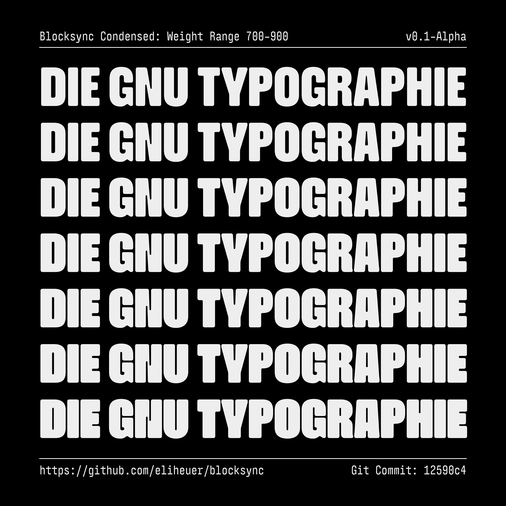

# Blocksync

[![][Fontspector]](https://eliheuer.github.io/blocksyncer/fontspector/fontspector-report.html)
[![][Universal]](https://eliheuer.github.io/blocksyncer/fontspector/fontspector-report.html)
[![][GF Profile]](https://eliheuer.github.io/blocksyncer/fontspector/fontspector-report.html)
[![][Outline Correctness]](https://eliheuer.github.io/blocksyncer/fontspector/fontspector-report.html)
[![][Shaping]](https://eliheuer.github.io/blocksyncer/fontspector/fontspector-report.html)

[Fontspector]: https://img.shields.io/endpoint?url=https%3A%2F%2Fraw.githubusercontent.com%2Feliheuer%2Fblocksyncer%2Fgh-pages%2Fbadges%2Foverall.json
[GF Profile]: https://img.shields.io/endpoint?url=https%3A%2F%2Fraw.githubusercontent.com%2Feliheuer%2Fblocksyncer%2Fgh-pages%2Fbadges%2FGoogleFonts.json
[Outline Correctness]: https://img.shields.io/endpoint?url=https%3A%2F%2Fraw.githubusercontent.com%2Feliheuer%2Fblocksyncer%2Fgh-pages%2Fbadges%2FOutlineCorrectnessChecks.json
[Shaping]: https://img.shields.io/endpoint?url=https%3A%2F%2Fraw.githubusercontent.com%2Feliheuer%2Fblocksyncer%2Fgh-pages%2Fbadges%2FShapingChecks.json
[Universal]: https://img.shields.io/endpoint?url=https%3A%2F%2Fraw.githubusercontent.com%2Feliheuer%2Fblocksyncer%2Fgh-pages%2Fbadges%2FUniversal.json

## About

A block-like variable font designed and engineered by Eli Heuer. In-development, not ready for use.

## Building

Fonts are built automatically by GitHub Actions - take a look in the [Actions](https://github.com/eliheuer/blocksyncer/actions) tab for the latest build.

If you want to build fonts manually on your own computer:

* `make preflight-only` will run the fast Google Fonts source-structure check.
* `make source-readiness` will validate the active designspace/UFO sources.
* `make build` will produce font files from `sources/Blocksync.designspace`.
* `make test` will run the [Fontspector](https://github.com/fonttools/fontspector) Google Fonts QA profile on the release variable font.
* `make proof` will generate HTML proof files.

The proof files and QA tests are also available automatically via GitHub Actions - look at https://eliheuer.github.io/blocksyncer.

## Google Fonts Release Work

The active release source path is designspace/UFO:

* `sources/config.yaml`
* `sources/Blocksync.designspace`
* active UFOs listed in `sources/README.md`

Historical `.glyphs` files live in `sources/archive/` and are not active build
inputs. Agent-oriented release notes and reusable Google Fonts workflow guidance
live in `AGENTS.md`, `GF_READINESS.md`, and `.agents/`.

Start future low-token Google Fonts release passes with:

* `.agents/README.md`
* `.agents/google-fonts-onboarding-checklists.md`
* `.agents/google-fonts-official-reference-map.md`

## Changelog

**26 September 2022. Version 0.1**
- Hello World

## License

This Font Software is licensed under the SIL Open Font License, Version 1.1. This license is available with a FAQ at: https://openfontlicense.org

## Repository Layout

This font repository structure is inspired by [Unified Font Repository v0.3](https://github.com/unified-font-repository/Unified-Font-Repository), modified for the [Google Fonts workflow](https://github.com/googlefonts/googlefonts-project-template).
