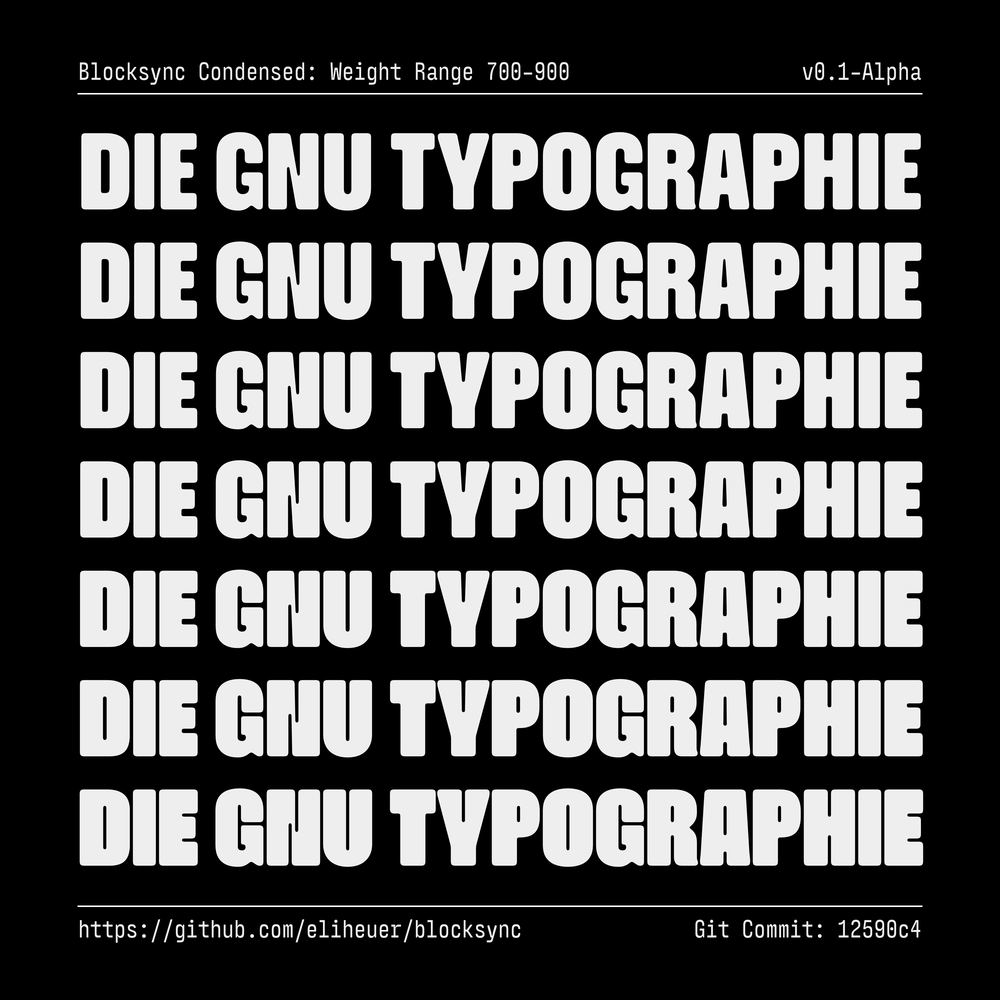

# Google Fonts Add Font issue draft

## Issue title

Add Blocksync

## Labels

I New Font, II Submission

## Draft body

**Font Project Git Repo URL**

[eliheuer/blocksync](https://github.com/eliheuer/blocksync)

**Super short description**

Blocksync is a block-like Latin display face by Eli Heuer. Its weight axis runs from 400 to 900 and its width axis from 75 to 125.

**Requirements**

- [x] The font project is available in a Github repository and licensed under the OFL. [License](https://github.com/eliheuer/blocksync/blob/main/OFL.txt)
- [x] I confirm that the public repository contains the entire family and that no larger retail, Plus or Pro edition exists.
- [x] The editable UFO masters, designspace and build configuration are publicly available. [Sources](https://github.com/eliheuer/blocksync/tree/main/sources)
- [x] I control the rights to all styles of Blocksync and license the family under the OFL. The submission includes a statement clearly disclosing if AI tools were used.
- [x] I confirm there are no Reserved Font Names affecting Blocksync in the project or its upstream materials, or will raise any applicable RFNs for discussion.
- [x] The FontData service returned zero matches at all six confidence levels for Blocksync on 2026-11-18. Its trademark flag was false. [Name search](https://namecheck.fontdata.com/api/?q=Blocksync)
- [x] I confirm the definitive app-menu family name is **Blocksync** and that it contains no copyright holder’s full name or acronym.
- [x] The variable font encodes the Google Fonts Latin Core glyphset. [Coverage](https://github.com/eliheuer/blocksync/blob/main/documentation/google-fonts-glyphset-coverage.md)
- [x] The project follows the Google Fonts preferred upstream repo structure and documents its build. [Build instructions](https://github.com/eliheuer/blocksync#building)
- [x] I have read and agree to the Google Fonts contribution requirements. The family is undergoing design and production review.
- [x] I will maintain the repository and participate in onboarding.

**AI-use disclosure**

AI tools assisted with build and CI configuration, documentation, QA, proof comparison and draft component construction. In this release, the quarter and three-quarter fractions use Blocksync’s existing numeral and slash drawings. Eli selected the heavier normal-width Black from rendered alternatives. The build interpolates the heavier styles from existing masters. New OpenType positioning and a combining macron below support accent sequences. The sources include Latin Extended and Vietnamese composites assembled by project scripts. The maintainer confirmed that this disclosure also covers earlier work.

**Current proof and QA**

The upstream design review has identified inconsistent Bold capitals, placeholder letterforms and colliding letter pairs. These remain open before submission. The candidate package contains one variable font. The project also builds 18 static instances for proofing. The release restores the weight progression at normal width and fills ¼ and ¾ from the family’s original numeral and slash components. The full font renders the Amarakaeri, Mezquital Otomi and Secoya specimens. Their combining macron below (U+0331) falls outside Google's Latin web subsets. We would appreciate onboarding guidance on serving those specimens. Package-context Fontspector reports 6 FAIL, 0 FATAL, 0 ERROR. The six failures are all the same serving issue. Standalone variable-font QA has three warnings for subset coverage, contour counts and outline alignment. [Print proof](https://eliheuer.github.io/blocksync/proof/proof.pdf) · [Two-axis proof](https://eliheuer.github.io/blocksync/proof/widths.html) · [Project QA details](https://github.com/eliheuer/blocksync/blob/main/CONTEXT.md#baseline-qa)

**Image**

## Maintainer review before posting

**Submission is on hold at the maintainer’s request.** On November 18, 2026, Eli confirmed the final name, upstream RFN status, rights to the full family, absence of a larger proprietary edition, maintenance commitment, agreement to the contribution requirements and scope of the AI disclosure. The public authors and contributors lists name Eli Heuer. The OFL header retains the historical Blocksyncer project name. Review the font quality and obtain Eli’s release decision before posting. [Add Font template](https://github.com/google/fonts/blob/main/.github/ISSUE_TEMPLATE/1_add-font.md)

The signed CLA identity matters when making a downstream PR. Eli has previously contributed to google/fonts, but the inspected public PR did not expose a CLA check result. Verify the agreement and matching Git identity before submitting a PR. [Past contribution](https://github.com/google/fonts/pull/6850) · [Google CLA](https://cla.developers.google.com/)
